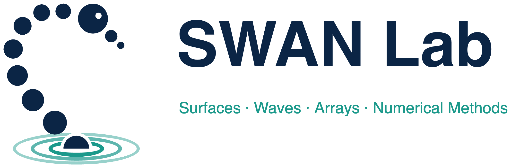

  <picture>
    <source media="(prefers-color-scheme: dark)" srcset="https://raw.githubusercontent.com/SWANLabHub/.github/main/profile/assets/swan_logo_dark.png">
    
  </picture>

**SWAN Lab** (Surfaces, Waves, Arrays & Numerical Methods) is the research group of [Mert Kalfa](https://mertkalfa.com) at Sabancı University, Istanbul. We are part of the Electronics Engineering program, Faculty of Engineering and Natural Sciences.

We build the theoretical, algorithmic, and physical building blocks of intelligent electromagnetic environments: surfaces and arrays that actively shape how waves travel, for sensing, localization, and communication.

### Research

- [**AI-augmented EM solvers**](https://mertkalfa.com/research/ai-augmented-solvers/): full-wave solvers that keep classical rigor but run at inference speed.
- [**Semantic & compressive sensing**](https://mertkalfa.com/research/semantic-compressive-sensing/): robust sensing that captures only what matters for the task.
- [**Goal-oriented EM design**](https://mertkalfa.com/research/goal-oriented-design/): designing the EM environment for the goal, not classical metrics.

### In this organization

Code, datasets, and figure scripts that go with our papers. Every figure in a release comes from a MATLAB or Python script in the same repository. Each repository states its license and how to cite it.

**Datasets**

- [Full-wave S-matrix and embedded element patterns of a 16 × 16 stacked-patch array](https://doi.org/10.5281/zenodo.23912674) (Zenodo, 2026, CC BY 4.0). Repository: [stacked-patch-array-16x16](https://github.com/SWANLabHub/stacked-patch-array-16x16).

### Join the group

We recruit M.Sc. and Ph.D. students. Strong undergraduates are welcome too. Read [how to apply](https://mertkalfa.com/contact/) and put **[Kalfa-Apply]** at the start of the e-mail subject.

[Website](https://mertkalfa.com/lab/) · [Google Scholar](https://scholar.google.com.tr/citations?user=YG7G5vMAAAAJ&hl=en) · [Contact](https://mertkalfa.com/contact/)
